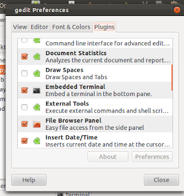
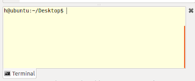
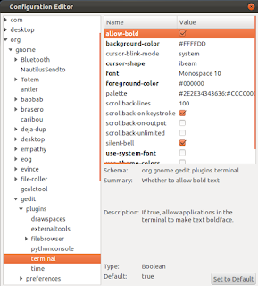
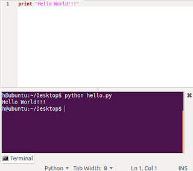

You can embed terminal right in gedit in it's bottom panel. Gedit has a plugin called “embedded terminal” which is by default not there in plugin lists of gedit. But you can install all remaining plugins using simple command:

```
user@ubuntu:~$ sudo apt-get install gedit-plugins
```

After that go to gedit edit>Preferences>Pluins and activate "embedded terminal". You can see that you also got some new cool plugins. You can activate them according to your need to extend your gedit.



But after activating Embedded Terminal you can see that theme of embedded terminal does not match with your default terminal.



You can fix that. But first you need to install `dconf-tools`. You can do this by issuing following command in terminal:

```
user@ubuntu:~$ sudo apt-get install dconf-tools
```

Now start `dconf-editor` by issuing command `dconf-editor` or from application menu.
In *dconf-editor* navigate to *org>gedit>plugins>terminal*.
Here you can edit background-color, foreground-color, fonts etc. according to your choice.



And you can get the look and feel you want for your embedded terminal in gedit.



HAPPY PROGRAMMING!!! :)
