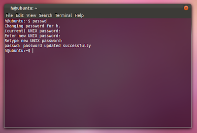

Changing your user account password in Ubuntu is fairly simple...
1) Open your terminal with Ctrl+Alt+t or from 'application menu>Accessories>Terminal'.
2) Type passwd
Type your current password
And then type your new password and then retype it. :)

